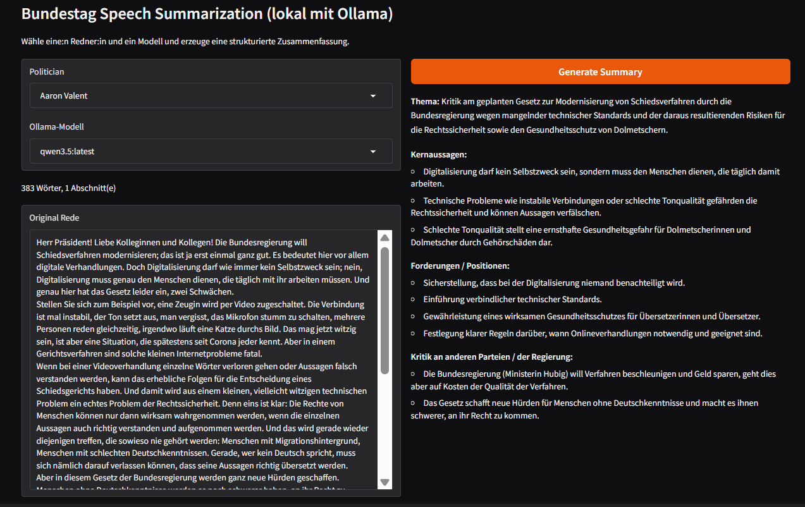

Long speeches are split into chunks and summarized in a map-reduce step.

## Setup

ollama pull llama3
ollama pull qwen3.5
conda env create -f environment.yml
python web_ui/gradio_summary_ollama.py

# Bundestag Speech Summarization

This repository downloads the plenary protocols of the German Bundestag
(XML, [Open Data](https://www.bundestag.de/services/opendata), accessed 31.10.2026),
extracts the speeches per speaker and summarizes them with locally hosted
Ollama models in a Gradio interface (see image).

Models:
- llama3:latest
- qwen3.5:latest

## Evaluation

The summaries were rated on a scale from 1 to 5 by Claude Haiku 5.5 acting as a judge, which receives the original speech
as reference and does not know which model wrote the summary:
- Factual consistency
- Argumentation
- Adherence to the required structure

Language quality (grammar and spelling) was measured separately with LanguageTool.

## Tests
The tests use pytest and run offline: the Bundestag download and Ollama
are replaced by fakes.
- Unit tests: XML extraction, chunking, sentiment averaging
- Integration tests: the summarization pipeline from XML to the Ollama
  requests, including map-reduce and error handling
- End-to-end tests: the Gradio app runs as a server and is queried over HTTP

Run `pytest` from the repository root. `pytest --run-live` additionally
runs a test against the real protocol and a local Ollama.